### `00 // THE CONSTRAINT`

I build neural networks **from the ground up in plain Python**: no PyTorch, no NumPy, just lists, loops and the math. If I can't build it by hand, I don't understand it yet.

### `01 // ACTIVE BENCH`

<a href="https://github.com/shayanlabs/ai-journey/tree/main/01-perceptron"></a>

> **On the desk now:** the neuron can guess and measure its own error. Next it needs the update rule that actually changes its weights. After that, the goal is to watch it fail at XOR, on purpose.

### `02 // EXPERIMENT LOG`

<a href="https://github.com/shayanlabs/ai-journey"></a>

| # | Experiment | Architecture | Math it unlocks | Status |
|---|---|---|---|---|
| 01 | [Perceptron](https://github.com/shayanlabs/ai-journey/tree/main/01-perceptron) | 2 inputs → 1 neuron | weights, bias, the perceptron rule | 🛠️ building |
| 02 | [XOR network](https://github.com/shayanlabs/ai-journey/tree/main/02-xor-network) | 2 → 2 → 1 | sigmoid, loss, backprop by hand | ⏳ next |
| 03 | AI Auction Arena | 8 bots, each with its own small brain | neuroevolution: the richest brains survive and mutate | 🗺️ planned |
| 04 | MNIST from scratch | 784 → hidden → 10 | gradient descent at scale | 🗺️ planned |

> 🏟️ **The one I can't wait for:** eight bots bid against each other for real cars. Nobody writes their strategy. Each one has its own neural-network brain, the poorest brains are replaced every season, and whatever tactics they end up with, they find themselves.

### `03 // FIELD NOTES & FAILURES`

Real mistakes from my notebook, kept on purpose.

<details>
<summary><b>I thought a neuron adds its weight to the input.</b></summary>
<br>

I wrote the total as `(weight + input) + bias`. Wrong: each input is **multiplied** by its own weight, the products are added, and then the bias. `0.4 × 1 + 0.9 × 0 − 0.3 = 0.1`, so the output is `1`.
</details>

<details>
<summary><b>I thought a bigger weight makes the neuron "pick" that input.</b></summary>
<br>

It never picks. Every input counts, and a bigger weight just pushes the total harder. With weights `5` and `3` and inputs `0` and `1`, only the second input changes anything, because `5 × 0` is still `0`.
</details>

<details>
<summary><b><code>(0.0)</code> is not a list.</b></summary>
<br>

Round brackets around one number give you one plain number. `[0.0, 0.0]` is a list, and `(0.0, 0.0)` is a tuple. One character, and the whole neuron breaks.
</details>

### `04 // HOW I BUILD`

```text
learn   → the idea first, with checks I have to pass
build   → step by step; I write every line, AI is my tutor and gives one hint, never the code
ship    → push it, then write down what broke and what clicked
```

### `05 // PING`

Building something from scratch too? Let's trade notes.
[LinkedIn](https://www.linkedin.com/in/shayanlabs) · [Instagram](https://www.instagram.com/shayan.code)

<sub><i>Build with purpose. Finish what you start. Share what you learn.</i></sub>
